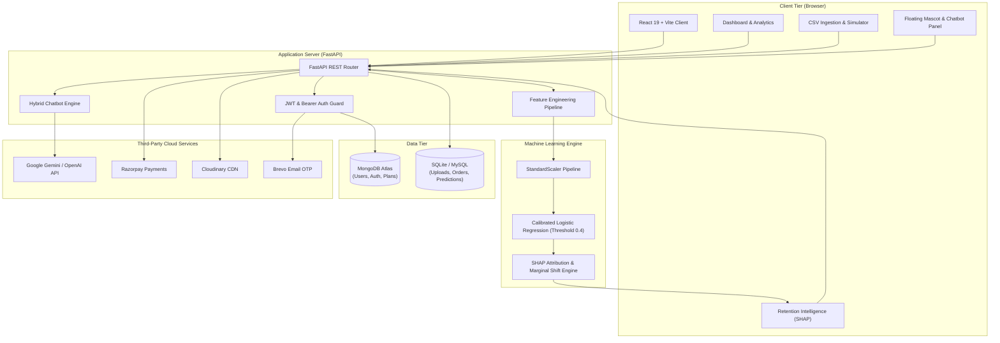
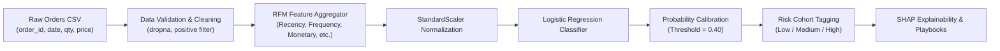

<div align="center">

# 🛡️ ChurnGuard AI
### AI-Based Customer Retention & Churn Prediction System

An end-to-end intelligent customer intelligence platform combining predictive machine learning, SHAP explainability, RFM cohort segmentation, and a hybrid AI retention assistant to proactively prevent customer defection.

[](https://fastapi.tiangolo.com)
[](https://react.dev)
[](https://vitejs.dev)
[](https://python.org)
[](https://scikit-learn.org)
[](https://tailwindcss.com)
[](https://www.mongodb.com)
[](https://www.sqlite.org)

</div>

---

## 📑 Table of Contents

- [1. Project Overview](#1-project-overview)
- [2. Key Features](#2-key-features)
- [3. Technology Stack](#3-technology-stack)
- [4. System Architecture](#4-system-architecture)
- [5. Machine Learning Pipeline](#5-machine-learning-pipeline)
- [6. Project Folder Structure](#6-project-folder-structure)
- [7. Installation and Setup](#7-installation-and-setup)
  - [Prerequisites](#prerequisites)
  - [Clone Repository](#clone-repository)
  - [Backend Setup](#backend-setup)
  - [Frontend Setup](#frontend-setup)
- [8. Environment Variables](#8-environment-variables)
- [9. API Documentation](#9-api-documentation)
- [10. Screenshots](#10-screenshots)
- [11. Future Enhancements](#11-future-enhancements)
- [12. Contributors](#12-contributors)
- [13. License](#13-license)

---

## 1. Project Overview

Acquiring a new customer costs 5 to 7 times more than retaining an existing one. Yet most organizations only discover a customer has churned long after their last purchase, when win-back efforts are least effective.

**ChurnGuard** is a full-stack, enterprise-grade customer intelligence and retention platform. It leverages calibrated statistical machine learning models trained on transactional history to compute precise, individual customer churn probabilities before defection occurs. 

Beyond delivering simple risk predictions, ChurnGuard introduces **Prescriptive Retention Intelligence**:
- Translates raw orders into actionable RFM (Recency, Frequency, Monetary) metrics.
- Uses **SHAP (SHapley Additive exPlanations)** to uncover the specific behavioral driver increasing churn risk for each individual customer account.
- Quantifies financial exposure in **Indian Rupees (₹)** by estimating Annual Revenue at Risk and Customer Lifetime Value (CLV).
- Provides tailored retention playbooks (such as win-back reactivation, basket expansion, or repeat habituation) and calibrated incentive budgets.
- Delivers an integrated, **hybrid AI Chatbot** combining local deterministic knowledge bases, live telemetry queries, and LLM reasoning.

---

## 2. Key Features

### 🔮 Predictive Intelligence & Churn Scoring
- **Automated Probability Scoring:** Calculates continuous churn probabilities (`0.0% – 100.0%`) for individual or batch-uploaded accounts.
- **Three-Tier Risk Cohorts:** Categorizes accounts into calibrated risk buckets:
  - 🟢 **Low Risk (< 30%):** Stable, habitual repeat buyers.
  - 🟡 **Medium Risk (30% – 60%):** Accounts showing slowing purchase frequency or moderate dormancy.
  - 🔴 **High Risk (> 60%):** Immediate defection danger requiring urgent intervention.
- **Calibrated Decision Boundary:** Calibrated classification threshold (`0.40`) optimized for high recall on at-risk accounts.

### 📊 Interactive Analytics Dashboard
- Real-time customer health telemetry: Total Accounts, Risk Distribution, Average Churn Probability, and Revenue Exposure.
- High-risk customer inspection tables with sortable RFM metrics and search filters.
- Recharts-powered distribution breakdowns and confusion matrix visualization.

### 🧠 Prescriptive Retention Intelligence & SHAP Interpretability
- **Dedicated SHAP Breakdown:** Individual feature contribution waterfall and horizontal bar charts highlighting whether each behavior increases or reduces churn risk.
- **Financial Impact Quantification:** Computes Annual Gross Revenue at Risk (`₹`) and 36-month projected Customer Lifetime Value (`₹`).
- **Tailored Playbooks:** Automatically recommends targeted playbooks (e.g. *Win-Back Reactivation Campaign*, *Basket Size Expansion Strategy*, *Repeat Purchase Habituation Playbook*).
- **Calibrated Incentives & Action Plan:** Recommends specific discount percentages, loyalty perks, and a phased 30-day outreach schedule.

### 📁 Dataset Management & Upload History
- **CSV Drag-and-Drop Ingestion:** Ingests raw transactional order CSV files (`customer_id`, `order_id`, `order_date`, `quantity`, `unit_price`).
- **Single-Customer Simulator:** Interactive form for evaluating a hypothetical customer profile in real time.
- **Upload History Management:** View previous uploads, summary statistics, processed record counts, and timestamps.
- **Safe Record Deletion:** Individual upload deletion with modal confirmation dialog and cascading cleanup across child tables (`upload_customers`, `orders`, `history`).
- **One-Click Excel Export:** Download detailed predictions as formatted `.xlsx` spreadsheets.

### 🤖 Hybrid AI Retention Chatbot
- **Interactive Floating Mascot:** Animated robot mascot with smooth entrance trajectories, upright orientation physics, and viewport-constrained dragging.
- **Layer A (Local Knowledge Base):** Instant deterministic answers for churn concepts, RFM methodology, model metrics, and retention strategies.
- **Layer B (LLM Fallback Engine):** Contextual natural-language conversations powered by Google Gemini (with OpenAI fallback).
- **Layer C (Live Telemetry Queries):** Dynamic SQL queries answering questions about the authenticated user's active customer dataset in real time.

### 🔐 Authentication & Enterprise Account Controls
- User signup and login with secure **bcrypt** password hashing and **PyJWT** session tokens.
- Email verification via **6-digit OTP** powered by Brevo (Sendinblue).
- Optional **Google OAuth** authentication.
- User profile management, password updates, and avatar uploads to **Cloudinary**.
- Subscription tiers and payment verification integrated with **Razorpay**.

---

## 3. Technology Stack

### Frontend
| Technology | Version | Purpose in ChurnGuard |
| :--- | :--- | :--- |
| **React** | `^19.3.1` | Modern component-based user interface with hooks and suspense |
| **Vite** | `^8.3.5` | Next-generation frontend build tool and lightning-fast HMR dev server |
| **Tailwind CSS** | `^4.3.3` | Utility-first CSS framework styled with custom luxury editorial palettes |
| **React Router DOM**| `^7.18.5` | Client-side routing, protected routes, and navigation state |
| **Recharts** | `^3.10.1` | Responsive SVG charts for SHAP attributions, cohort distributions, and metrics |
| **Lottie React** | `^3.1.2` | Vector animations for landing page illustrations and feedback states |
| **Supabase JS** | `^2.118.0` | Client-side authentication and cloud sync provider |

### Backend & Machine Learning
| Technology | Version | Purpose in ChurnGuard |
| :--- | :--- | :--- |
| **Python** | `3.12` | Core backend runtime and computational engine |
| **FastAPI** | `^0.115` | High-performance asynchronous REST API framework with automatic OpenAPI docs |
| **Uvicorn / Gunicorn** | Latest | Production ASGI web server implementation |
| **Scikit-learn** | `^1.6` | Machine learning model training, preprocessing pipelines, and evaluation |
| **Pandas & NumPy** | Latest | Data manipulation, feature engineering, and matrix operations |
| **Joblib** | Latest | Serialized machine learning pipeline persistence |
| **Pydantic** | `^2.10` | Strict data validation, schema enforcement, and serialization |

### Databases & Cloud Integrations
| Technology | Role & Integration |
| :--- | :--- |
| **MongoDB Atlas** | Document store for user profiles, OTP credentials, onboarding states, and subscription tiers. |
| **SQLite (`churnguard.db`)** | Local relational database storing dataset uploads, individual predictions, orders, and action logs. |
| **MySQL / TiDB** | Supported enterprise relational cloud backend with SSL/TLS encryption (`ca.pem`). |
| **Google Gemini API** | Primary LLM intelligence (`gemini-2.5-flash`) for natural-language retention questions. |
| **OpenAI API** | Secondary resilient LLM fallback engine for uninterrupted chatbot operations. |
| **Razorpay** | Payment order creation, webhook signature verification, and plan tier upgrades. |
| **Cloudinary** | Secure cloud storage and image optimization for user profile avatars. |
| **Brevo (Sendinblue)** | Transactional email delivery service for one-time verification passcodes (OTP). |

---

## 4. System Architecture



---

## 5. Machine Learning Pipeline



### 1. Data Cleaning & Sanitization
The system validates required columns (`customer_id`, `order_id`, `order_date`, `quantity`, `unit_price`). Dates are parsed to UTC timestamps, and invalid rows (negative quantities, zero prices, missing IDs) are discarded.

### 2. Feature Engineering
From raw transaction rows, the pipeline computes 6 behavioral customer attributes:
- **`recency_days`:** Days elapsed between the customer's last order and the dataset snapshot date (`max_date - customer_last_date`).
- **`frequency`:** Total count of distinct orders placed (`nunique(order_id)`).
- **`monetary`:** Cumulative lifetime spend across all transactions in Indian Rupees (`₹`).
- **`tenure_days`:** Total account longevity from initial purchase to dataset snapshot date.
- **`total_items`:** Cumulative quantity of physical units purchased.
- **`avg_order_value`:** Average monetary spend per order basket (`monetary / frequency`).

### 3. Model Architecture & Evaluation
During offline experimentation, three candidate models were benchmarked:

| Model Architecture | Accuracy | Precision | Recall | F1-Score | ROC-AUC | 5-Fold CV ROC-AUC |
| :--- | :---: | :---: | :---: | :---: | :---: | :---: |
| **Logistic Regression (Selected)** | **66.3%** | **60.6%** | **62.1%** | **0.613** | **0.717** | **0.743** |
| Random Forest Classifier | 63.8% | 57.7% | 59.7% | 0.586 | 0.702 | 0.736 |
| Gradient Boosting Classifier | 63.8% | 57.7% | 59.7% | 0.586 | 0.699 | 0.731 |

**Why Logistic Regression was chosen:**
- Offers stable, well-calibrated posterior probabilities (`predict_proba`).
- High 5-fold cross-validated ROC-AUC (`0.743`).
- Provides exact linear SHAP attributions without approximation variance, allowing explainable predictions in real-time.

---

## 6. Project Folder Structure

```
AI-Based-Customer-Retention-And-Churn-Predection/
├── backend/
│   ├── chatbot/
│   │   ├── analytics.py           # Live telemetry query generation for active cohorts
│   │   ├── gemini_service.py      # Google Gemini client with OpenAI / Groq fallbacks
│   │   ├── intents.json           # Intent definitions and sample pattern training data
│   │   ├── intent_engine.py       # Pattern-matching and tokenization intent classifier
│   │   ├── rag.py                 # ChurnGuard domain knowledge retrieval engine
│   │   └── service.py             # Chatbot orchestrator combining Layers A, B, and C
│   ├── ml/
│   │   ├── baseline_model.joblib  # Reference baseline scikit-learn pipeline
│   │   ├── churn_model.joblib     # Production serialized pipeline (Scaler + Classifier)
│   │   ├── features.py            # Transaction aggregation and RFM feature extractor
│   │   ├── insights.py            # Feature importance and training evaluation metrics
│   │   ├── model_report.json      # Model performance benchmarks & confusion matrix
│   │   ├── predictor.py           # Single and batch inference runner with thresholding
│   │   └── retention_intelligence.py # SHAP attribution, revenue-at-risk, & playbooks
│   ├── routes/
│   │   ├── chat.py                # REST endpoints for chat messaging and session history
│   │   ├── onboarding.py          # Organization onboarding flow and business profiling
│   │   ├── payment.py             # Razorpay order generation and signature verification
│   │   └── retention.py           # Endpoints for SHAP analysis and action tracking
│   ├── schemas/
│   │   └── customer.py            # Pydantic models for single and batch prediction payloads
│   ├── auth.py                    # User authentication, OTP verification, and JWT security
│   ├── db.py                      # SQLite/MySQL schema, connection pools, and CRUD ops
│   ├── email_service.py           # Brevo transactional email sender for OTP passcodes
│   ├── exports.py                 # OpenPyXL Excel export builder for customer reports
│   ├── main.py                    # FastAPI application initialization and route mounting
│   ├── mongo.py                   # MongoDB Atlas client and user collection management
│   ├── photo.py                   # Cloudinary profile image upload handler
│   ├── plans.py                   # Subscription tier definitions and quota enforcement
│   └── requirements.txt           # Python backend dependencies
├── frontend/
│   ├── public/
│   │   ├── data/
│   │   │   └── sample_orders.csv  # Sample e-commerce orders file for testing
│   │   └── favicon.svg            # ChurnGuard SVG favicon
│   ├── src/
│   │   ├── api/
│   │   │   └── index.js           # Centralized API fetch client with token handling
│   │   ├── assets/                # Lottie vector animation JSON files
│   │   ├── components/
│   │   │   ├── chatbot/           # Floating mascot robot and expanded chat window
│   │   │   ├── dashboard/         # Dashboard metrics cards and distribution charts
│   │   │   ├── retention/         # Floating retention trigger badge
│   │   │   └── ...                # Reusable UI components (Buttons, Modals, Cards)
│   │   ├── context/
│   │   │   ├── AuthContext.jsx    # User session and authentication state provider
│   │   │   └── PlanContext.jsx    # Subscription tier and quota state provider
│   │   ├── pages/
│   │   │   ├── Dashboard.jsx      # Main customer analytics and cohort overview
│   │   │   ├── History.jsx        # Upload history, details modal, and record deletion
│   │   │   ├── Predict.jsx        # Single-customer real-time risk simulator
│   │   │   ├── RetentionIntelligence.jsx # Dedicated SHAP analytics & playbooks page
│   │   │   ├── Upload.jsx         # Drag-and-drop CSV batch upload page
│   │   │   └── ...                # Auth, Landing, Profile, Pricing pages
│   │   ├── App.jsx                # Router configuration and application shell
│   │   └── index.css              # Tailwind CSS imports and luxury theme variables
│   ├── package.json               # Node.js dependencies and build scripts
│   └── vite.config.js             # Vite configuration with Tailwind CSS v4 plugin
├── .env.example                   # Sanitized template for environment variables
├── .gitignore                     # Git ignore rules for secrets, venv, and dependencies
└── README.md                      # Comprehensive project documentation
```

---

## 7. Installation and Setup

### Prerequisites
- **Python:** `3.10` or higher (`3.12` recommended)
- **Node.js:** `v18.0.0` or higher (`v20+` recommended)
- **npm:** `v9.0.0` or higher
- **MongoDB:** Active MongoDB Atlas cluster URI or local MongoDB instance

### Clone Repository
```bash
git clone https://github.com/Neerajyadav604/AI-Based-Customer-Retention-And-Churn-Predection.git
cd AI-Based-Customer-Retention-And-Churn-Predection
```

---

### Backend Setup

1. **Navigate to the backend directory:**
   ```bash
   cd backend
   ```

2. **Create and activate a virtual environment:**
   - **Windows (PowerShell):**
     ```powershell
     python -m venv venv
     .\venv\Scripts\Activate.ps1
     ```
   - **macOS / Linux:**
     ```bash
     python3 -m venv venv
     source venv/bin/activate
     ```

3. **Install dependencies:**
   ```bash
   pip install --upgrade pip
   pip install -r requirements.txt
   ```

4. **Configure environment variables:**
   Create a `.env` file inside `backend/` (or copy `.env.example` from the root):
   ```bash
   cp ../.env.example .env
   ```
   *Fill in your `MONGODB_URI`, `JWT_SECRET`, and optional API keys.*

5. **Start the FastAPI backend server:**
   ```bash
   uvicorn main:app --host 127.0.0.1 --port 8000 --reload
   ```
   *The API will be available at `http://127.0.0.1:8000` (Interactive Swagger Docs at `http://127.0.0.1:8000/docs`).*

---

### Frontend Setup

1. **Navigate to the frontend directory:**
   ```bash
   cd ../frontend
   ```

2. **Install Node.js dependencies:**
   ```bash
   npm install
   ```

3. **Configure environment variables:**
   Create a `.env` file in `frontend/`:
   ```env
   VITE_API_URL=http://localhost:8000
   ```

4. **Start the Vite development server:**
   ```bash
   npm run dev -- --host 127.0.0.1
   ```
   *Open your browser at `http://127.0.0.1:5173` to access ChurnGuard.*

---

## 8. Environment Variables

Below is the complete reference of environment variables supported by ChurnGuard:

### Backend Variables (`backend/.env`)

| Variable Name | Required | Default | Description |
| :--- | :---: | :---: | :--- |
| `APP_ENV` | Optional | `development` | Environment mode (`development` or `production`). |
| `PORT` | Optional | `8000` | Port for the backend server to bind to. |
| `FRONTEND_URL` | Optional | `http://localhost:5173` | Allowed origin for Cross-Origin Resource Sharing (CORS). |
| `JWT_SECRET` | **Yes** | — | Cryptographic secret key used to sign and verify user JWT tokens. |
| `MONGODB_URI` | **Yes** | — | MongoDB Atlas connection string for user account profiles. |
| `MYSQL_HOST` | Optional | — | Host address for remote MySQL/TiDB database. |
| `MYSQL_PORT` | Optional | `3306` | Port for remote MySQL database. |
| `MYSQL_USER` | Optional | — | Username for remote MySQL database. |
| `MYSQL_PASSWORD` | Optional | — | Password for remote MySQL database. |
| `MYSQL_DB` | Optional | — | Database name for remote MySQL database. |
| `GEMINI_API_KEY` | Optional | — | Google Gemini API key for Chatbot Layer B intelligence. |
| `OPENAI_API_KEY` | Optional | — | OpenAI API key used as fallback for chatbot queries. |
| `RAZORPAY_KEY_ID` | Optional | — | Razorpay Public Key ID for subscription payments. |
| `RAZORPAY_KEY_SECRET` | Optional | — | Razorpay Private Key Secret for signature verification. |
| `CLOUDINARY_CLOUD_NAME`| Optional | — | Cloudinary cloud account name for user avatars. |
| `CLOUDINARY_API_KEY` | Optional | — | Cloudinary API key. |
| `CLOUDINARY_API_SECRET`| Optional | — | Cloudinary API secret. |
| `BREVO_API_KEY` | Optional | — | Brevo (Sendinblue) API key for sending email verification OTPs. |
| `MAIL_SENDER_EMAIL` | Optional | — | Sender email address for OTP verification emails. |

### Frontend Variables (`frontend/.env`)

| Variable Name | Required | Default | Description |
| :--- | :---: | :---: | :--- |
| `VITE_API_URL` | Optional | `http://localhost:8000` | Target URL for backend REST API requests. |
| `VITE_RAZORPAY_KEY_ID`| Optional | — | Public Razorpay key used by client-side checkout modal. |
| `VITE_SUPABASE_URL` | Optional | — | Supabase project URL for optional OAuth flows. |
| `VITE_SUPABASE_ANON_KEY`| Optional | — | Supabase anon key for public client calls. |

---

## 9. API Documentation

### Core Endpoints

#### `GET /health`
* **Purpose:** Health check verifying server status and active environment.
* **Response:**
  ```json
  {
    "status": "ok",
    "deployment": "local",
    "environment": "development"
  }
  ```

#### `POST /predict`
* **Purpose:** Predicts churn probability for a single customer profile in real time.
* **Headers:** `Authorization: Bearer <JWT_TOKEN>`
* **Request Body:**
  ```json
  {
    "recency_days": 45,
    "frequency": 3,
    "monetary": 1250.00,
    "tenure_days": 180,
    "total_items": 8
  }
  ```
* **Response:**
  ```json
  {
    "churn_probability": 0.382,
    "risk_level": "Medium",
    "likely_to_churn": false
  }
  ```

#### `POST /predict/batch`
* **Purpose:** Uploads a CSV dataset of transaction orders and returns batch churn predictions.
* **Headers:** `Authorization: Bearer <JWT_TOKEN>`, `Content-Type: multipart/form-data`
* **Body:** Form data containing `file: <orders.csv>`
* **Response:**
  ```json
  {
    "summary": { "total": 5, "high": 1, "medium": 2, "low": 2 },
    "customers": [
      {
        "customer_id": "14688",
        "recency_days": 92,
        "frequency": 2,
        "monetary": 11193.49,
        "churn_probability": 0.684,
        "risk_level": "High"
      }
    ],
    "upload_id": 16,
    "dataset_id": "16",
    "filename": "orders_q4.csv"
  }
  ```

#### `GET /uploads` & `GET /upload/history`
* **Purpose:** Lists all previous dataset uploads belonging to the authenticated user.
* **Headers:** `Authorization: Bearer <JWT_TOKEN>`

#### `DELETE /uploads/{upload_id}`
* **Purpose:** Permanently deletes a specific upload and its associated customer and order records.
* **Headers:** `Authorization: Bearer <JWT_TOKEN>`
* **Response:**
  ```json
  {
    "success": true,
    "detail": "Upload record #16 and all associated data permanently deleted."
  }
  ```

#### `GET /api/retention/analysis/{upload_id}`
* **Purpose:** Generates full SHAP interpretability metrics, financial loss projections in ₹, and personalized playbooks for a dataset.
* **Headers:** `Authorization: Bearer <JWT_TOKEN>`

#### `POST /api/chat`
* **Purpose:** Sends a message to the hybrid AI chatbot assistant.
* **Request Body:**
  ```json
  {
    "message": "How many customers are at high risk?",
    "session_id": "user_session_1"
  }
  ```
* **Response:**
  ```json
  {
    "reply": "### Live Customer Cohort Telemetry ✦\n\nBased on your latest uploaded dataset, 1 account is currently categorized as High Risk (>60%).",
    "intent": "live_metrics_query",
    "layer": "Layer C: Live Telemetry",
    "sources": ["Customer Risk Cohorts & Thresholds", "Live Customer Cohort Analytics"],
    "suggestions": ["How can I reduce customer churn?", "Explain high-risk customers."]
  }
  ```

---

## 10. Screenshots

> *Place application screenshots inside your repository's asset directory to display live previews.*

| View | Preview |
| :--- | :--- |
| **Landing Page** | `` |
| **Authentication & Onboarding** | `` |
| **Main Dashboard & Cohorts** | `` |
| **SHAP Retention Intelligence** | `` |
| **Upload History & Deletion** | `` |
| **AI Robot Chatbot** | `` |

---

## 11. Future Enhancements

The following capabilities are roadmap considerations for future versions of ChurnGuard:
- [ ] **Automated Webhook Triggers:** Outbound webhooks to Zapier, Make, or Klaviyo when an account crosses into the High Risk tier.
- [ ] **CRM Integrations:** Direct bidirectional synchronization with Salesforce, HubSpot, and Shopify stores.
- [ ] **Deep Learning Models:** Recurrent Neural Networks (LSTM) or Transformer architectures for sequential purchase time-series modeling.
- [ ] **Automated Multi-Armed Bandit Testing:** A/B testing framework to compare retention discount conversions across cohorts.

---

## 12. Contributors

- **Neeraj Yadav** — [GitHub (@Neerajyadav604)](https://github.com/Neerajyadav604)
- **Neha Bankar** — [GitHub (@Nehabankar25)](https://github.com/Nehabankar25)

---

## 13. License

This project is currently distributed without an explicit open-source license. All rights are reserved by the contributors. For inquiries regarding licensing, commercial use, or partnership opportunities, please contact the repository contributors.
